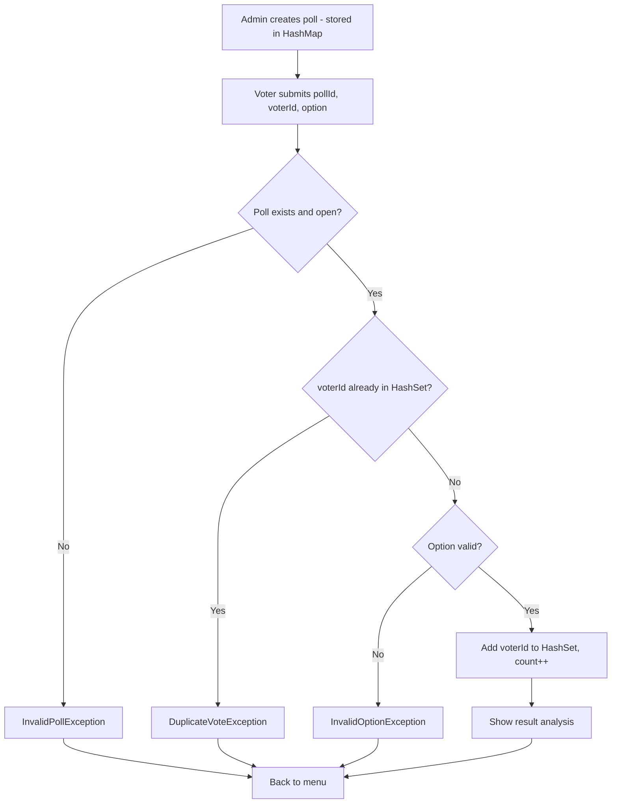

# Secure Online Polling & Result Analysis System

A console-based Java application that lets an admin create polls, lets voters cast votes, validates every vote, prevents duplicate voting, and analyzes the results.

## Features

- Create polls with a question and multiple options
- Vote validation (poll exists, option is valid)
- Duplicate-vote prevention (one vote per voter per poll)
- Result analysis: total votes, per-option percentage, winner and tie detection
- Custom exceptions for clean error handling
- Close a poll to stop accepting votes

## Concepts Used

| Concept | Where it is used |
|---|---|
| `HashMap` | Stores polls by ID, and option-to-vote-count inside each poll |
| `HashSet` | Stores voter IDs who have already voted (O(1) duplicate check) |
| OOP | `Poll`, `PollManager` and `Main` classes with encapsulation |
| Exception Handling | Custom exceptions plus try-catch in the menu loop |

## Project Structure

```
SecurePollingSystem/
├── Main.java                      # Menu-driven entry point
├── Poll.java                      # Poll data + voting logic
├── PollManager.java               # Manages all polls (HashMap)
├── InvalidPollException.java
├── DuplicateVoteException.java
└── InvalidOptionException.java
```

## How It Works

**Data structures**

```
PollManager
 └── HashMap<Integer, Poll>            pollId -> Poll

Poll
 ├── HashMap<String, Integer>          option -> vote count
 └── HashSet<String>                   voterIds that have voted
```

**Algorithm**

1. Show the menu: Create Poll, Vote, View Results, Close Poll, Exit.
2. **Create Poll:** read the question and options, set every count to 0, store the poll in the HashMap with a unique ID.
3. **Vote:** read `pollId`, `voterId` and `option`, then:
   - If the poll does not exist or is closed, throw `InvalidPollException`.
   - If `voterId` is already in the HashSet, throw `DuplicateVoteException`.
   - If the option is not in the options map, throw `InvalidOptionException`.
   - Otherwise add `voterId` to the HashSet and increment the option's count.
4. **View Results:** compute the total votes, each option's percentage, and the winner (or tie).
5. Catch any exception, print its message, and return to the menu.
6. Repeat until the user chooses Exit.

**Voting flowchart**



## Getting Started

**Requirements:** JDK 8 or higher

```bash
# compile
javac *.java

# run
java Main
```

## Sample Run

```
===== Secure Polling System =====
1. Create Poll
2. Vote
3. View Results
4. Close Poll
5. Exit
Choice: 1
Question: Best programming language?
Options (comma separated): Java, Python, C++
Poll created with ID: 101

Choice: 2
Poll ID: 101
Voter ID: S1001
Option: Java
Vote recorded successfully.

Choice: 2
Poll ID: 101
Voter ID: S1001
Option: Python
Error: Voter S1001 has already voted in this poll.

Choice: 3
Poll ID: 101
Java   : 1 vote  (100.0%)
Python : 0 votes (0.0%)
C++    : 0 votes (0.0%)
Winner: Java
```

## Exceptions

| Exception | Thrown when |
|---|---|
| `InvalidPollException` | Poll ID does not exist or the poll is closed |
| `DuplicateVoteException` | The voter has already voted in that poll |
| `InvalidOptionException` | The chosen option is not part of the poll |

## Future Enhancements

- Hash voter IDs (e.g. SHA-256) before storing them
- Save and load polls from a file or database
- Poll expiry time
- Admin login and role-based access
- GUI or web front end

## Authors

Shubh Pandey | Roll No.: 2502052563 | Course: Object Oriented Programming

Arpit Singh | Roll No.: 2502052568 | Course: Object Oriented Programming
