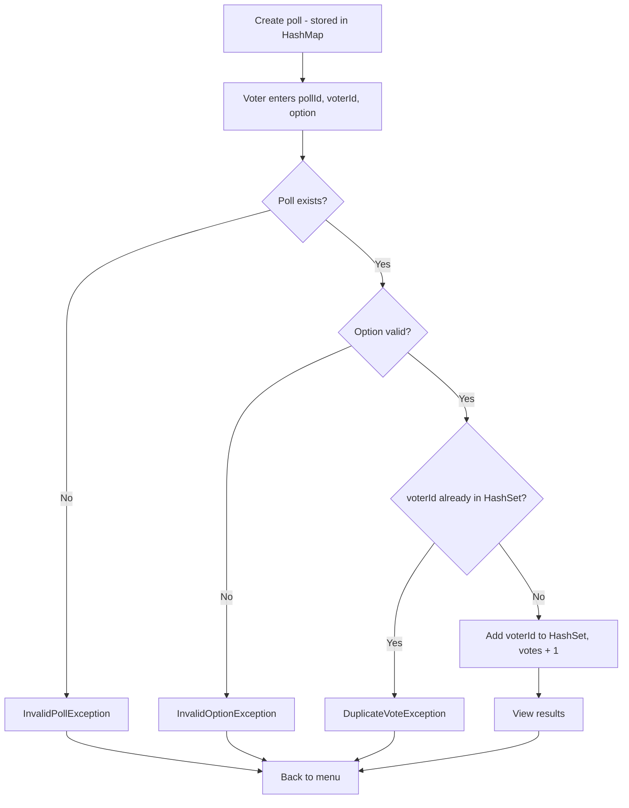

# Secure Online Polling & Result Analysis System

A console-based Java application where polls can be created, votes are validated, duplicate voting is prevented, and results are calculated.

## Features

- Create a poll with a question and two or more options
- Vote in a poll using a voter ID
- Duplicate-vote prevention (one vote per voter per poll)
- Vote validation (poll must exist, option must be valid)
- Result analysis: total votes, percentage per option, winner or tie
- List all polls

## Concepts Used

| Concept | Where it is used |
|---|---|
| HashMap | `PollManager` stores polls by ID; `Poll` stores option -> vote count |
| HashSet | `Poll` stores voter IDs to block duplicate votes |
| OOP | `Poll`, `PollManager` and `Main` classes with private fields and public methods |
| Exception Handling | Custom exceptions plus try-catch in `Main` |

## Project Structure

```
SimplePolling/
├── Main.java                    # Menu and user input
├── PollManager.java             # Stores and manages all polls
├── Poll.java                    # One poll: options, votes, voters, results
├── InvalidPollException.java
├── DuplicateVoteException.java
└── InvalidOptionException.java
```

## How It Works

**Data structures**

```
PollManager
 └── HashMap<Integer, Poll>        pollId -> Poll

Poll
 ├── ArrayList<String>             list of options
 ├── HashMap<String, Integer>      option -> number of votes
 └── HashSet<String>               voter IDs that have already voted
```

**Voting algorithm**

1. The user enters the poll ID, voter ID and option.
2. `PollManager` finds the poll. If it does not exist, it throws `InvalidPollException`.
3. `Poll` checks the option. If it is not in the poll, it throws `InvalidOptionException`.
4. `Poll` checks the HashSet. If the voter ID is already there, it throws `DuplicateVoteException`.
5. Otherwise the voter ID is added to the HashSet and the option's vote count goes up by 1.

**Result analysis**

- Percentage = (votes of option / total votes) x 100, rounded to 1 decimal place
- The winner is the option with the highest count; if more than one option has that count, it is a tie
- If no votes have been cast, "No votes yet." is printed

**Voting flowchart**



## Getting Started

**Requirements:** JDK 8 or higher

```bash
cd SimplePolling
javac *.java
java Main
```

## Sample Run

```
=== Online Polling System ===
1. Create Poll
2. Vote
3. View Results
4. List All Polls
5. Exit
Enter your choice: 1
Enter question: Best programming language?
Enter options (comma-separated): Java, Python, C++
Poll created successfully with ID: 1

Enter your choice: 2
Enter Poll ID: 1
Question: Best programming language?
Options: [Java, Python, C++]
Enter Voter ID: S1001
Enter Option: Java
Vote recorded successfully.

Enter your choice: 2
Enter Poll ID: 1
Question: Best programming language?
Options: [Java, Python, C++]
Enter Voter ID: S1001
Enter Option: Python
Error: Voter S1001 has already voted in this poll.

Enter your choice: 3
Enter Poll ID: 1

Results for Poll 1: Best programming language?
Total votes: 1
Java: 1 votes (100.0%)
Python: 0 votes (0.0%)
C++: 0 votes (0.0%)
Winner: Java
```

## Exceptions

| Exception | Thrown when |
|---|---|
| `InvalidPollException` | The poll ID does not exist |
| `InvalidOptionException` | The option is not part of the poll, or a poll has fewer than 2 options |
| `DuplicateVoteException` | The voter has already voted in that poll |

## Limitations

- Data is kept in memory only, so polls are lost when the program exits
- Voter IDs are not verified or encrypted

## Future Enhancements

- Save and load polls from a file
- Hash voter IDs (for example with SHA-256) before storing them
- Close and delete polls
- Search polls by keyword
- GUI or web front end

## Author

Your Name | Roll No. | Course / Department
